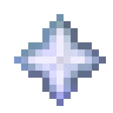

The Crystal is an item, Soulbound to your account that allows you to quickly access many different menus. It cannot be dropped, or destroyed. 

Going from top to bottom, left to right, the menu is in a strange orientation. Wonder why?

The **Head** at the top displays your username, and overall rank. 

The next item is called "**Here**", and it's a dynamic item that shows you where you are, the biome, and if applicable, displays a banner if you're in any Hearth's territory. 

The **Vigil** item displays a menu that can be clicked and shows how much vigil you can hold, and allows you to withdraw or deposit Vigil from your bar. 

The **Hearth Banner** only shows up when you have been assigned a Hearth, or created one. It displays a menu when clicked that allows you to manage your Hearth, and see other related information.

The **Spyglass** shows different statistics about your account. 

The **Alerts** menu shows Warden, Lookout, and Ledger Chest information, up to a week. You can toggle and filter between different alerts.

The **Roster** item displays your hearth, and suggested players to add to your Hearth. Captain/Mate only.

The **Warden** shows your placed Wardens, and existing alerts. Captain/Mate only.

The **Lookout** shows your placed Lookouts, and existing alerts. Captain/Mate only.

The **Link** item lets you link your discord to your Minecraft account. This allows you to receive Discord pings when Wardens or Lookouts alert. 

The **Chat** icon lets you toggle between Global or Hearth chat. 

The **Vote** icon lets you vote for the server to earn extra vigil separate from the daily cap.

