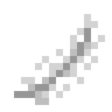

**Overview**
Banishment is how players enact judgement and punishment on Osprey, without admins actively monitoring the server. Kill someone with a weapon enchanted with Banishment, and they will be exiled to the nether, bound to a feather that drops on the floor on kill. They stay there indefinitely as long as someone fuels the feather with [Vigil](/wiki/items/vigil/). 

When a banishing kill lands, an item called **Feather of [Player]** drops where the victim died. Whoever picks it up holds that player's sentence.

- **It's a normal item.** Put it in a chest, a vault, a shulker box or your inventory. It can be traded, sold or stolen like anything else.
- **You can't log out with it.** If the holder disconnects, the feather drops on the ground where they stood. 
- **The prisoner always knows where it is.** The banished player can see the feather's live coordinates at all times, whether it's in a chest, on the ground or in someone's inventory. It is updated once a minute. 

Because the prisoner can always see where it is, a feather can't simply be buried and forgotten. Keeping it safe means guarding it, usually inside a Warden-protected vault.

You can refuel the Feather with Vigil stored in your bar by accessing the Vigil menu, and then clicking on the Feather icon in your inventory.
