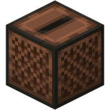

# Overview

The Jukebox Lookout is a jukebox that watches everything within **11 blocks** of it, in every direction including up and down. Think of it like a forcefield that records everything within 11 blocks.  When an outsider walks in, logs in or logs out nearby, every member of your Hearth is told. It also keeps a log of what they did there, which you can read later.

To anyone outside your Hearth it's an ordinary jukebox. It takes discs and plays them, so there's no way to spot one by clicking it.

There is also a cheaper **Noteblock Lookout**, which sends entry alerts but keeps no log and has no levers.

## Making and placing one

**Recipe**: a jukebox in the centre of the crafting grid with 8 Vigil around it.

**Naming**: rename the jukebox in an anvil before you craft or place it. The name shows in every alert and menu, such as "Home". An unnamed one is just called "a Lookout". To rename one later, break it, rename it and place it again.

**Placing**: put it down anywhere you're allowed to place blocks, including outside your own land. A Warden's field still stops outsiders from placing one inside it.

**Who owns it**: it belongs to your Hearth, and every member gets everything: alerts, the log and the controls. If you're a Wanderer it serves only you, and it joins your Hearth's list when you join one.
Your own members, and the Wanderer who owns it, never set it off or appear in its log.

## Alerts

Every time an outsider enters its range, logs in or logs out there, each online member gets a chat line such as `MRDOGO5779 entered Mill gate [world 120 64 -40]`. 

There's no cooldown, so they're reported once per entry, and again only after leaving and coming back. 
The same alerts land in your Crystal's Alerts inbox, kept for a week, so you can catch up on what happened while you were offline. Repeat visits by the same player within 10 minutes are grouped into one line there ("entered Mill gate, 4 times").
You can switch off the chat lines with Entry alerts: on/off in the Crystal's Lookouts list. That applies to all your Lookouts, just for you, and alerts still reach the inbox.

## The log

The jukebox records everything an outsider does in range, with the player, time and position:

| Alert Type | Actions logged |
| --- | --- |
| Movement | Enter, login, logout |
| Blocks | Break, place, ignite |
| Buckets | Empty, fill |
| Containers | Open |
| Kills | Mob, player |
| Vehicles, Mounts | Enter vehicle, exit vehicle, destroy vehicle, mount, dismount |

To read it, right-click the jukebox (members only) or open it from the Crystal, then choose Read the log. Entries show as a chest of icons, newest first, 45 to a page. Each icon tells you the action at a glance: the player's head for movement, the block for block actions, a chest for containers and a spawn egg for kills.
To narrow it down, click the filter icon to cycle through action types, or click an entry to show only that player. Entries are kept for 30 days. Clear the log wipes it after a confirmation click.

## Lever Mode

A Jukebox Lookout can output redstone signal on its sides when an outsider does something nearby. Each side means a different action. Wire redstone to those sides to make alarms, lights, doors or traps that react to intruders on their own. 

| Side of the jukebox |  |
| :--- | :--- |
| North (toward negative Z) | walks into range, logs in, or logs out within range |
| East (toward positive X) | places a block |
| South (toward positive Z) | opens a container: a chest, barrel, furnace and so on |
| West (toward negative X) | breaks a block |

#### Setting it up

1. Place your Jukebox Lookout.
2. Open its page: right-click it as a member, or use the Crystal's Lookouts icon.
3. Turn Levers on. It starts off on every new Lookout, which is the most common reason it "doesn't work for me bruh"
4. Connect an output directly on the side of the jukebox for each action you want (table above). It must be on the jukebox's wall: not on the floor or ceiling, and not a block away. 
5. Run redstone from the jukebox itself (see **Wiring**).

Press F3 to check which way you're facing: north is the direction where your Z coordinate goes down. The other logged actions (killing mobs or players, buckets, fire, boats, minecarts and mounts) are recorded in the log but don't flip any lever.

#### Who sets it off

• Only outsiders: anyone not in the Lookout's Hearth, or for a Wanderer's Lookout, anyone but its owner.

• Members never trigger it, so testing with your own Hearth-mates won't flip anything. Ask someone from outside your Hearth to help.

• Walking into range fires once each time someone crosses into the 11-block cube. Standing still inside doesn't keep the lever on.

#### Wiring

• The lever mode powers redstone like any lever, so dust, lamps and repeaters next to it react. Wire from one side to react to just that side's action.

• While a lever is on, the jukebox itself is powered too, just as a vanilla lever powers the block it hangs on. Redstone touching the jukebox reacts to every side at once.

• The pulse lasts about 1 second. For an alarm that stays on until someone resets it, run it into a pulse extender or a latch, such as an RS latch or a copper bulb.

• A music disc in the jukebox keeps playing and stays put.

• If a lever is already on, for example because someone flipped it by hand, that side won't pulse until it's switched off again.

#### When nothing happens

• Levers is off on the Lookout's page (the default).

• The lever isn't on the jukebox's wall, or it's on the wrong side.

• The person is a member of your Hearth, or in spectator mode.

• The Lookout is dormant (see Upkeep). A member walking within range wakes it up.

• It's a Noteblock Lookout. (for the complete idiots who dont see the notch on the top)

**Ideas**
• A lamp or bell at your base wired from the north lever: someone's at the gate.

• A door that slams shut through a latch when an outsider walks in.

• The west lever into a dispenser for a "you broke our wall" trap.

• A separate lamp for each side, so you can see at a glance what kind of thing is happening.

### Discord alerts

Lookout alerts can also go to Discord, so you hear about visitors when you're not in game.
Linking your account (every member)

1. Open your Crystal, go to Discord and click Link Discord. The menu closes and chat shows a code that lasts 10 minutes, plus a link to Osprey's own Discord server.

2. Join Osprey's Discord if you aren't in it yet, then type /link CODE there or in a DM with the Osprey bot.

3. The bot replies to you alone, and the game tells you "Linked to Discord as …". Your Discord page in the Crystal now shows Unlink Discord and Pings: on/off.

**Inviting the bot to your Hearth's server (Captain only)**
Your Hearth's alerts go to a channel in your own Discord server, so the Osprey bot has to be added there first.

1. Get the invite. Open your Crystal, go to Discord and click Send Hearth alerts to Discord. The menu closes and chat shows two steps: a link to add the bot, and a code that lasts 10 minutes.

2. Add the bot. Click the link. Discord opens an "Add to server" page. Pick your Hearth's server and click Authorize. Discord only lists servers where you have the Manage Server permission. The bot asks for three permissions: view channels, send messages and embed links. Keep all three.

3. Choose the channel. In the channel you want, such as #raids, type /osprey-alerts CODE. Only members with the Manage Channels permission can see this command.

4. Check it worked. The bot posts "Your Hearth's Warden and Lookout alerts will come to this channel", and in game you're told "Your Hearth's alerts now go to #raids in Mill server". The Discord page in your Crystal now shows the channel.

_If it doesn't work_

• "I can't post here": give the bot permission to view that channel, send messages and embed links in the channel's settings, then type the command again.

• "Use this in a channel of your server": the command was typed in a DM. It has to be in a server channel.

• The code expired or you're no longer Captain: get a fresh code from the Crystal. A new code also moves alerts to a different channel.

To stop sending alerts, click the channel icon on your Crystal's Discord page. Wardens use the same channel, so their alerts arrive there too.
Wanderers have no Hearth channel, so their own Lookouts' alerts come by DM instead.

Each alert pings every linked member who has Pings on. Turn yours off on your Discord page. The in-game Entry alerts switch only mutes chat lines; it doesn't stop Discord.

### Upkeep: keeping it awake and watching

A Jukebox Lookout needs no fuel, only visits. Any member walking within its 11-block range refreshes it.

1. **Active**: works normally.
2. **Dormant after 6 weeks without a member visit**: it stops noticing anyone until a member comes by, which wakes it straight back up.
3. **Culled after 12 weeks without a visit**: it turns into an ordinary jukebox for good and its log is deleted.

The Crystal's Lookouts list shows each one's state and countdown, such as "Active, dormant in 5 days" or "Dormant, culled in 3 weeks". Clicking a Lookout there opens its page.

### Breaking one

| Who breaks it | What happens |
| :--- | :--- |
| A member, or the Wanderer who owns it | You get the Lookout back, still named. Its log is deleted. |
| An outsider | They get only a plain jukebox, and the 8 Vigil is lost. They're told whose it was ("That was a Lookout of Birchwood, Captain Steve"), and its owners get an alert: `MRDOGO5779 broke your Lookout Storage Room` |

Pistons can't move it and explosions don't destroy it. Sneak-right-click lets members place blocks against it as normal.

# Final Notes and Tips

• You should name all lookouts, just so you know what specific one was triggered.  "Mill gate entered" tells you where to go; "a Lookout entered" doesn't really if you have a big fuckin network of em

• A lookout's radius of an 11-block cube is small. Put Lookouts on roads, gates and tunnels to get warning before someone reaches difficult things, and there's no cost to using them if you actually frequent the area you placed them.

• Use the lever system! The Jukebox Lookout is like a human observer, it's very good for trapping and keeping track of who's on your territory.

• Only place them in areas that you actually frequent, so a Lookout far from home only stays awake if a member passes within 11 blocks every few weeks. Do patrols if you're using them to guard borders. 

• Filters are extremely useful! Filter by Break or Open to see exactly what was taken, then click the culprit to see everything they did.
