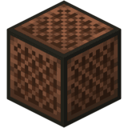

# Overview
The Noteblock Lookout is a note block that watches everything within 11 blocks of it, in every direction including up and down. When an outsider walks in, logs in or logs out nearby, every member of your Hearth is told.

To anyone outside your Hearth it's an ordinary note block. Clicking it still changes its note, so there's no way to spot one by clicking it.

It's the cheaper of the two Lookouts. It only sends alerts, so it keeps no record of what visitors did and has no lever outputs. For those, use a Jukebox Lookout. Imo, if you're really broke, just don't bother and just save up the Vigil for a Jukebox Lookout.

## Making and placing one
**Recipe**: a note block in the centre of the crafting grid, with 4 Vigil above, below and on both sides of it (the corners stay empty).

**Naming**: rename the note block in an anvil before you craft or place it. The name shows in every alert, such as "Mill gate". An unnamed one is just called "a Lookout". To rename one later, break it, rename it and place it again.

**Placing**: put it down anywhere you're allowed to place blocks, including outside your own land. Spying on neighbours is part of the game. A Warden's field still stops outsiders from placing one inside it.

**Who owns it**: it belongs to your Hearth, and every member gets its alerts. If you're a Wanderer it serves only you, and it joins your Hearth's list when you join one.

Your own members, and the Wanderer who owns it, never set it off. Players in spectator mode aren't seen either.

## Alerts
Every time an outsider enters its range, logs in or logs out there, each online member gets a chat line such as `MRDOGO5779 entered Mill gate [world 120 64 -40]`. There's no cooldown: someone is reported once per entry, and again only after leaving and coming back. Standing still inside the range doesn't repeat it.

The same alerts land in your Crystal's Alerts inbox, kept for a week, so you can catch up on what happened while you were offline. Repeat visits by the same player within 10 minutes are grouped into one line there ("entered Mill gate, 4 times"). Clicking an alert opens that Lookout's page.

You can switch off the chat lines with Entry alerts: on/off in the Crystal's Lookouts list. That applies to all your Lookouts, only for you, and alerts still reach the inbox.

The Lookouts list in your Crystal shows every Lookout you own, with its type, name, position and state.

## Discord alerts

Lookout alerts can also go to Discord, so you hear about visitors when you're not in game.
Linking your account (every member)

1. Open your Crystal, go to Discord and click Link Discord. The menu closes and chat shows a code that lasts 10 minutes, plus a link to Osprey's own Discord server.

2. Join Osprey's Discord if you aren't in it yet, then type /link CODE there or in a DM with the Osprey bot.

3. The bot replies to you alone, and the game tells you "Linked to Discord as …". Your Discord page in the Crystal now shows Unlink Discord and Pings: on/off.

**Inviting the bot to your Hearth's server (Captain only)**
Your Hearth's alerts go to a channel in your own Discord server, so the Osprey bot has to be added there first.

1. Get the invite. Open your Crystal, go to Discord and click Send Hearth alerts to Discord. The menu closes and chat shows two steps: a link to add the bot, and a code that lasts 10 minutes.
2. Add the bot. Click the link. Discord opens an "Add to server" page. Pick your Hearth's server and click Authorize. Discord only lists servers where you have the Manage Server permission. The bot asks for three permissions: view channels, send messages and embed links. Keep all three.
3. Choose the channel. In the channel you want, such as #raids, type /osprey-alerts CODE. Only members with the Manage Channels permission can see this command.
4. Check it worked. The bot posts "Your Hearth's Warden and Lookout alerts will come to this channel", and in game you're told "Your Hearth's alerts now go to #raids in Mill server". The Discord page in your Crystal now shows the channel.

_If it doesn't work_

• "I can't post here": give the bot permission to view that channel, send messages and embed links in the channel's settings, then type the command again.

• "Use this in a channel of your server": the command was typed in a DM. It has to be in a server channel.

• The code expired or you're no longer Captain: get a fresh code from the Crystal. A new code also moves alerts to a different channel.

To stop sending alerts, click the channel icon on your Crystal's Discord page. Wardens use the same channel, so their alerts arrive there too.
Wanderers have no Hearth channel, so their own Lookouts' alerts come by DM instead.

Each alert pings every linked member who has Pings on. Turn yours off on your Discord page. The in-game Entry alerts switch only mutes chat lines; it doesn't stop Discord.

## What's sent
• Entered, logged in, logged out: the same player at the same Lookout within 10 minutes edits the first message ("Grimwald entered Mill gate, 4 times") instead of pinging again.

• Lookout broken.

Each alert pings every linked member who has Pings on. The in-game Entry alerts switch only mutes chat lines; it doesn't stop Discord.

## Upkeep: keeping it awake and watching

A Lookout needs no fuel, only visits. Any member walking within its 11-block range refreshes it.

1. **Active**: works normally.
2. **Dormant after 6 weeks without a member visit**: it stops noticing anyone until a member comes by, which wakes it straight back up.
3. **Culled after 12 weeks without a visit**: it turns into an ordinary jukebox for good and its log is deleted.

The Crystal's Lookouts list shows each one's state and countdown, such as "Active, dormant in 5 days" or "Dormant, culled in 3 weeks". Clicking a Lookout there opens its page.

## Breaking one

| Who breaks it | What happens |
| :--- | :--- |
| A member, or the Wanderer who owns it | You get the Lookout back, still named. Its log is deleted. |
| An outsider | They get only a plain noteblock, and the 8 Vigil is lost. They're told whose it was ("That was a Lookout of Birchwood, Captain Steve"), and its owners get an alert: `MRDOGO5779 broke your Lookout Storage Room` |

Pistons can't move it and explosions don't destroy it. Sneak-right-click lets members place blocks against it as normal.

# Final Notes and Tips

• You should name all lookouts, just so you know what specific one was triggered.  "Mill gate entered" tells you where to go; "a Lookout entered" doesn't really if you have a big fuckin network of em

• A lookout's radius of an 11-block cube is small. Put Lookouts on roads, gates and tunnels to get warning before someone reaches difficult things, and there's no cost to using them if you actually frequent the area you placed them.

• Only place them in areas that you actually frequent, so a Lookout far from home only stays awake if a member passes within 11 blocks every few weeks. Do patrols if you're using them to guard borders. 

• Filters are extremely useful! Filter by Break or Open to see exactly what was taken, then click the culprit to see everything they did.
