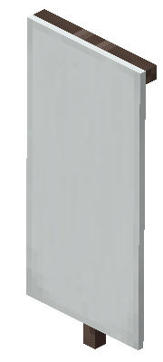

# Overview

The Standard is the banner you raise to found a Hearth. You design it in a loom, name it in an anvil and craft it with Vigil. Its design becomes your Hearth's banner and its name becomes your Hearth's name.
Once raised, the Standard marks where your Hearth was founded. 

## Crafting one

Once you live with at least 2 other players, the server notices and you get the advancement `A Place Worth Keeping`, with the same hint in chat. The Standard's recipe unlocks in your recipe book at the same moment.

1. Design a banner in a loom: any colour, any patterns.
2. Name it in an anvil. The name is your Hearth's name, so choose carefully: 3 to 24 characters, and not already used by another Hearth.
3. Craft it: the banner in the centre of the crafting grid with 8 Vigil filling every slot around it.

The result is a Standard: the same banner with the same colour, patterns and name, plus an enchanted glint.

**EXTREMELY IMPORTANT: Design and name it first**. Once crafted, a Standard can't be re-patterned in a loom or renamed in an anvil. An unnamed banner still crafts, but the Standard won't raise until it has a name, so you'd have to start again with a new banner.

## Raising it: founding a Hearth

Place the Standard on the ground. It founds a Hearth only when all of these are true:

| Requirement | Details |
| :--- | :--- |
| **You're not already in a Hearth** | You're standing on your settlement's land. The server must already see you living with others there. A lone homestead doesn't count. |
| **2 witnesses are nearby** | At least 2 other people who live in your settlement, within 16 blocks, online, and not in a Hearth. |
| **The Standard has a good name** | 3 to 24 characters, not used by another Hearth (capitals don't count as different). |
| **It's on the ground** | A Standard won't hang on a wall. Read The Fucking Placement Rules |

If anything's missing, nothing is placed and you're told which requirement failed, such as how many witnesses you still need.

**As soon as all these are fufilled**:

• The whole server hears that your Hearth has been founded.

• You become its Captain, and the witnesses become Crew.

• The founding date is recorded and shows in your Crystal's Hearth menu.

• Other people who live in your settlement appear as suggested members in the Roster, ready to be accepted.

Solo players can't found a Hearth.

## The placed Standard

Once raised, the Standard is a marker showing your Hearth's banner where it was founded. Your Hearth's name, banner, members and land all carry on whether the Standard is standing or not.

• **Explosions, pistons and mobs can't destroy** or move it.

• **A Standard can't be placed anywhere else**, except to raise it again on its own Hearth's land.

## Breaking and moving it

| Who | What happens |
| :--- | :--- |
| **Your Captain or a Mate** | It breaks and drops the Standard, design and name intact. |
| **Crew, or anyone outside your Hearth** | Breaking it is refused. |
| **The block underneath is removed** | The Standard pops off and drops as the Standard, not a plain banner. |

## Edge Cases / Closing Thoughts

The Standard is fundamentally the core of your Hearth, so place it in a spot with maximum Aura. 
Endermen cannot move it, and it's grief proof, so place it in a spot others can see and bask in the glory.
If you encounter an error, contact staff through modmail.
